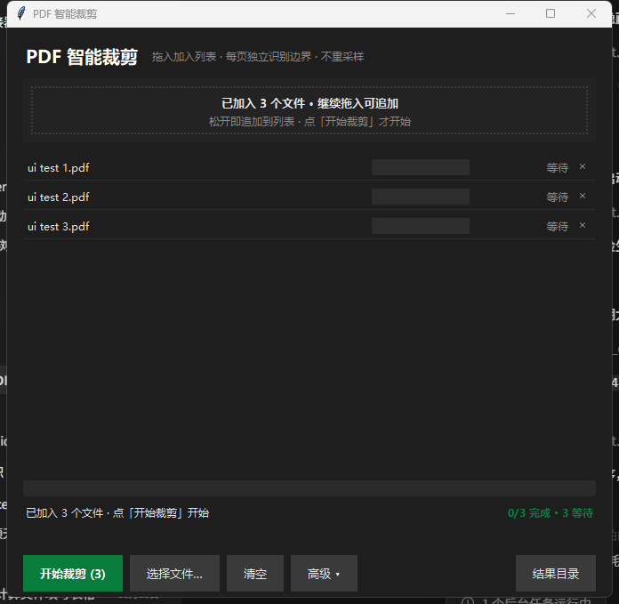
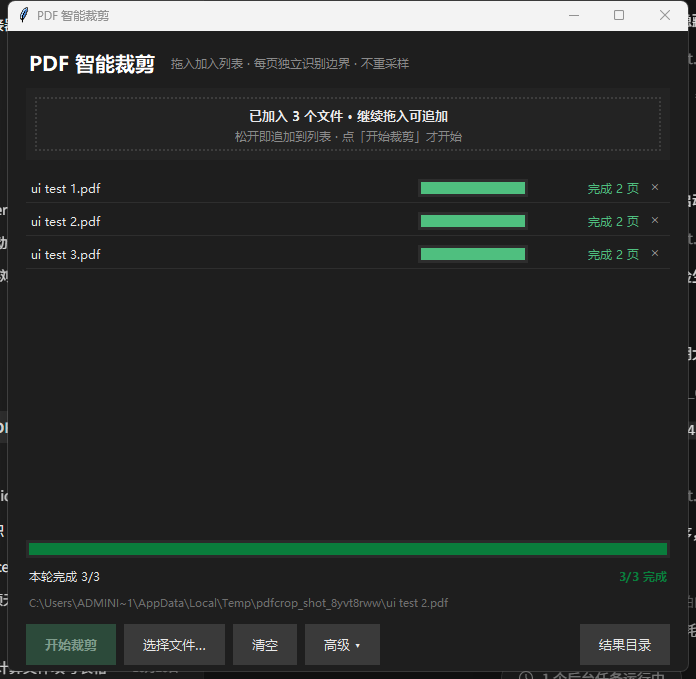

<div align="center">

# ✂️ PDF-CropMaster

### High-Performance, Multi-Core PDF Auto-Cropping Tool (Each Page Independently)

**Designed for scanned docs, oversized margins, and complex CAD blueprints! Independent page detection · 100% Lossless Vector · Multi-core Parallel · Say goodbye to WPS/Acrobat single-page clicking.**

[](https://opensource.org/licenses/MIT)
[](https://www.python.org/)
[]()
[](https://pymupdf.readthedocs.io/)

[中文文档](README.md) · [Features](#-key-features) · [Preview](#-ui-preview) · [Quick Start](#-quick-start) · [CLI Usage](#-cli-usage-guide) · [Architecture](#-how-it-works)

</div>

---

## 📌 Why PDF-CropMaster?

When cropping PDF margins using standard office software (like WPS Office or Adobe Acrobat), users face severe limitations:
1. **WPS "Smart Selection" only works one page at a time**: If you apply a crop box to "All Pages", it blindly enforces Page 1's bounding box across the entire document. If different pages have varying margins (e.g. mirrored book margins, CAD drawings), text and tables will either get cut off or retain huge white borders.
2. **Scanned CAD blueprints fail with standard scripts**: Standard tools extract bounding boxes from text or vector paths. However, CAD-exported scans often slice pages into dozens of page-wide strip images. The union of these strips covers the entire canvas, resulting in **zero margin removed**.
3. **Destructive re-sampling**: Many web tools rasterize the PDF into low-res bitmaps, making text non-selectable, non-searchable, and bloating file sizes.

**PDF-CropMaster solves all these issues cleanly and reliably.**

---

## ✨ Key Features

- 🎯 **Each-Page Independent Auto Crop**  
  No rigid single-template enforcement. Calculates the true content bounding box for each page independently.
- 🔍 **Intelligent Dual-Engine Detection**  
  - **Vector Engine**: Scans text blocks, embedded image rects, and vector drawings (tables, borders, lines). Uses pure float scalar accumulation for maximum speed.
  - **Pixel Engine**: Detects full-coverage slice image scans and automatically switches to an optimized **72 DPI grayscale row-scanning algorithm** (processing an oversized 1191×2105 page in just 0.016s — 75x faster than naive pixel iteration).
- 💎 **100% Lossless Vector Preservation**  
  Modifies only the underlying `CropBox`. Never recompresses images or breaks vector text streams. Text remains crystal-clear, searchable, and selectable.
- ⚡ **Multi-Core Parallel Acceleration**  
  Bypasses Python GIL via a dedicated worker process pool. Fully utilizes all physical CPU cores with preemptive work-stealing tasks.
- 📊 **Three Cropping Modes**  
  - `each` (Default): Independent bounding box per page. Maximum compactness.
  - `uniform`: Aligns all pages to the median dimensions. Perfect for clean book reading.
  - `union`: Bounding box of all pages combined. Safest conservative choice.
- 🖥️ **Three Interfaces: Desktop GUI / Web UI / CLI**  
  - Modern dark-themed Desktop GUI with drag-and-drop batch queue and per-file progress bars.
  - Lightweight built-in Web GUI accessible via browser.
  - Full-featured CLI for automation and server integration.

---

## 📸 UI Preview

### Desktop GUI (Tkinter / TkinterDnD2)
> Drag and drop multiple PDF files with per-file progress tracking and batch controls:

| Queue & Waiting | Multi-Core Processing Completed |
|:---:|:---:|
|  |  |

---

## 🚀 Quick Start

### Option 1: Standalone Windows Executable

Download the latest `PDF-CropMaster.exe` from [GitHub Releases](https://github.com/cai4415/pdf-cropmaster/releases).
- No Python installation required.
- Double-click to launch the GUI and drag in your files!

### Option 2: Run from Source (Windows / macOS / Linux)

```bash
# 1. Clone repository
git clone https://github.com/cai4415/pdf-cropmaster.git
cd pdf-cropmaster

# 2. Install dependencies
pip install -r requirements.txt

# 3. Launch Desktop GUI
python main.py

# Launch Web UI
python main.py --web-gui

# Or run via CLI
python main.py input.pdf
```

---

## 💻 CLI Usage Guide

```bash
# Basic crop (outputs input_已裁剪.pdf by default)
python auto_crop_pdf.py input.pdf

# Specify custom output path
python auto_crop_pdf.py input.pdf -o output.pdf

# Set custom margin padding (default: 6 mm)
python auto_crop_pdf.py input.pdf -m 8

# Use points (pt) as padding unit
python auto_crop_pdf.py input.pdf --unit pt -m 15

# Crop only specific page ranges
python auto_crop_pdf.py input.pdf --only 1-20,35,40-50

# Uniform mode (median dimensions across all pages)
python auto_crop_pdf.py input.pdf --mode uniform

# Dry-run analysis without saving files
python auto_crop_pdf.py input.pdf --dry-run
```

---

## 🛠️ Building Standalone Windows EXE

We provide an automated build script and custom Hook for `tkinterdnd2`:

```bash
pip install pyinstaller
python build_exe.py
```
Output will be generated at `dist/PDF-CropMaster.exe`.

---

## 📄 License

This project is licensed under the [MIT License](LICENSE).
